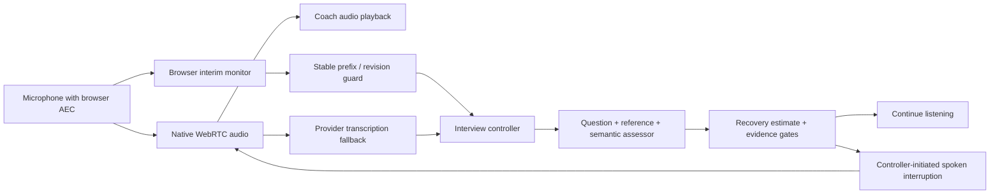

# Recovery-aware, model-initiated intervention

The target is **the interviewer interrupting an ongoing candidate answer**, not merely ending a turn when VAD detects silence. VAD answers “is there speech?”; the semantic controller answers “should the interviewer intervene now?”. These decisions stay separate.

## A narrow, testable probability target

Let `Y = 1` mean: within the next 15 seconds, the candidate produces at least one relevant, technically defensible reasoning step **without an intervention**. The operational output is an estimate `p = P(Y = 1 | recent answer, question/reference, progress history)`.

Version `recovery-v1` is an explicit **heuristic logistic score**, not a fitted or calibrated probability:

```text
z = -1.4 + 2.8·R + 1.7·C + 1.5·P + 3.2·S + 2.2·B
         - 0.9·min(D,3) - 3.4·E - 0.5·Q
p = sigmoid(z)
```

| Factor | Operational definition                                                                            |
| ------ | ------------------------------------------------------------------------------------------------- |
| R      | Current relevance, 0–1. Local mode uses term overlap; AI uses the question/reference and context. |
| C      | Technical correctness: 1 correct, 0.02 incorrect, 0.5 unknown. “Unknown” is not treated as wrong. |
| P      | 1 for productive reasoning/new evidence, except when the current claim is known wrong.            |
| S      | 1 for an explicit self-correction; protects the candidate's chance to finish it.                  |
| B      | 1 for a plausible connection back to the question.                                                |
| D      | Distinct substantive drift/repetition windows. An unchanged partial does not increment this.      |
| E      | 1 only for an identified technical error with an exact supporting quote.                          |
| Q      | 1 when repetition exceeds 0.8 without progress.                                                   |

A literal direct skip/give-up request uses the conversational-control branch (`p=0.01`) and advances immediately; this is a candidate choice, not an inferred inability. Quoted statements, uncertainty followed by reasoning, and self-corrections must not be treated as surrender.

## Actions and constraints

- **p ≥ 0.55:** listen. Preserve productive thinking and plausible bridges.
- **0.20 < p < 0.55:** observe; after at least two distinct drift windows, offer a targeted redirect (eight-second redirect cooldown).
- **p ≤ 0.20:** interrupt and advance only with sufficient assessment confidence plus a specific error or at least two substantive drift windows.
- **Explicit skip:** advance immediately, bypassing the old minimum answer time and cooldown.
- **Self-correction / bridge:** protect the floor even if an earlier part of the thought was wrong.
- **Thinking override:** protect thirty seconds from inferred interventions; an explicit skip and the fixed total budget still apply.
- **Low known ASR confidence (<0.72) or assessment confidence (<0.8):** abstain from the technical verdict. Missing browser confidence is not fabricated into a numeric value. Direct intent and sufficiently supported conversational checks remain available, while competency evidence requires trusted finalized text.

Urgent content decisions do **not** wait for silence. Long-pause support retains a separate 18-second tolerance, one nudge per silent interval, and a twenty-second support cooldown. The interview's fixed time budget always wins.

## Streaming and transport



Browser interim monitoring is a sidecar, not a claim that the native provider emits pre-end-of-turn transcripts. Where the monitor is unavailable, provider transcription may only support turn-level decisions. A stable interim prefix can trigger an intervention but cannot add competency evidence. Candidate audio remains on in native mode. Browser fallback uses automatic half-duplex turn-taking.

On interruption, cancel generation, immediately mute client playback, clear provider audio buffers, and truncate the assistant item at a conservative elapsed playback time. Do not put the full intended-but-unheard utterance into semantic-assessor context. The assessor receives candidate text, not coach generated tails. The export distinguishes intended text, completed playback, and interrupted playback. Audio-time truncation is not word-level forced alignment.

Cooperative acknowledgments (“yeah”, “uh-huh”, “right”) do not cancel playback. Actual floor requests (“stop”, “wait”, a clarification/correction) do. The initial classifier is text-based and cannot distinguish the enrolled candidate from background speakers. AEC and noise suppression are requested browser features, not verified acoustic isolation.

## Calibrating the estimate

Collect consented **listen-only** continuation windows so that `Y` is observable without intervention confounding. Annotate return-to-topic, technical defensibility and acceptable interruption windows independently. Split by participant. Fit/calibrate on development data (e.g. logistic regression and held-out isotonic calibration), freeze thresholds, then report Brier score, ECE/reliability curves, timing/action F1, harmful cut rate, recovery misses and subgroup results on held-out participants. Choose thresholds under an explicit maximum false-interruption constraint.

Measure input/audio-to-stable-text, stable-text-to-decision, decision-to-first-output-audio, and audio cancellation delay separately. Report p50/p95 under real network/device conditions. The often-quoted 160–240 ms native audio latency is not an end-to-end semantic intervention guarantee. No such latency or benchmark superiority is claimed here.

Implementation API references (contracts checked against official `openai@7.57.0` SDK types):

- [Realtime WebRTC](https://developers.openai.com/api/docs/guides/realtime-webrtc)
- [Realtime conversation events](https://developers.openai.com/api/docs/guides/realtime-conversations)
- [OpenAI Node realtime event types](https://github.com/openai/openai-node/blob/master/src/resources/realtime/realtime.ts)
