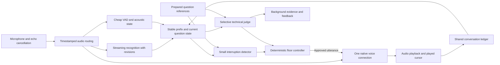

# Research proposal: faster, recovery-aware voice interruptions

Researched 17 November 2026. Code reviewed: `6e432d1`. This is a proposed architecture, not a deployed model upgrade. Source-reported results, proposed targets and illustrative calculations are distinguished below. No new model was trained and no live audio latency benchmark was run for this research.

## Recommendation

Use **one conversational voice, a continuously running lightweight observer, and a stronger technical judge invoked selectively**. Separate deciding *whether to interrupt* from composing the explanation and scoring the answer. Only an application controller may take the floor.

For the next implementation, retain the existing native WebRTC voice while improving streaming perception and splitting the assessor. This isolates whether the interruption controller improves. In a subsequent comparison, replace the native voice model with streaming TTS: our controller already specifies the words to speak, so a second model reasoning over all incoming audio might provide little additional value for its cost. A streaming STT/TTS system can keep listening while speaking; that transport behavior does not require a native speech-to-speech model.

Running two complete voice assistants continuously and choosing between their answers is a poor default. It duplicates audio encoding, context processing and generation; creates conflicting floor decisions; and requires either waiting for both or trusting whichever finishes first. Parallelism reduces elapsed time only when work is independent and compute/network capacity is available.

## What the primary sources establish

| Source | Verified finding | Consequence for Cadence |
| --- | --- | --- |
| Moshi [1] | Two simultaneous audio streams; 7B temporal transformer; authors report 160 ms theoretical latency and practical latency as low as 200 ms on an L4 GPU. | Native full duplex is feasible. These figures do not measure detecting an interview error, estimating recovery, or our complete application. |
| Kyutai STT [2] | Streaming, word timestamps; documented delay of 0.5 s for the 1B English/French model and 2.5 s for the 2.6B English model. | A larger recognizer can defeat the interruption latency budget before the judge runs. Measure time until the decisive word is usable, not just transcription throughput. |
| Unmute [3] | Streams LLM output into TTS. Its deployment notes report approximately 750 ms TTS latency on a shared L40S versus approximately 450 ms on its separately hosted setup. | A cascade need not wait for complete outputs. Resource contention matters; this deployment comparison is not a controlled speedup prediction for us. Its default response trigger still waits for the user to stop. |
| Silero VAD [4] | Authors report processing a 30+ ms audio chunk in under 1 ms on one CPU thread. | Speech detection can be cheap. Its decision is speech/non-speech, not technical correctness or likelihood of recovery. Sustained-speech confirmation adds a separate observation delay. |
| FireRedChat [5] | Self-hosted modular ASR, TTS, personalized VAD and end-of-turn detection. | Useful architecture for audio routing and speaker filtering; no demonstrated interview-recovery policy in the inspected README. |
| OpenAI / Google SDKs [6, 7] | OpenAI supports controller-triggered responses, cancellation, buffer clearing and audio truncation; Google exposes activity handling and an interrupted-generation signal. | These are building blocks for floor control. They do not establish semantic interruption accuracy or equivalent behavior across providers. |
| Qwen3-Omni [8] | Thinker–Talker architecture separates reasoning and speech generation internally. | Supports investigating specialization within a model. It is not evidence that two independent hosted voice assistants are faster, or that this model solves interview interruption. |
| Model Interruption Bench [9] | The available GSM8K evaluation uses synthesized correct/incorrect spoken solutions and judges mid-speech corrections, including timing and false interruptions. | A relevant external regression benchmark. It does not cover job interviews, uncertainty, or spontaneous recovery. We have not run it. |

Some documentation and paper hosts were unavailable from this environment. Findings above come from the linked, inspected official repositories and SDKs. Their inspected revisions are pinned in the references. Paper links inside repositories were not treated as papers read. The old LiveKit text turn-detector plugin is now marked deprecated in its repository [10]; avoid building a new integration against that obsolete plugin.

## Where the current implementation spends time

| Current code | Finding | Proposed change |
| --- | --- | --- |
| [`shared/trajectory.ts`](../shared/trajectory.ts), [`server/index.ts`](../server/index.ts) | Interim assessment requires a 900 ms eligibility hold from the tracked prefix anchor and is checked on a 150 ms timer. A growing prefix can reuse that anchor, so this is not an additional 900 ms for every word. | Event-driven handling of stable semantic changes. Replace the uniform hold with a measured stability/ambiguity rule; preserve protection for “I don't know … but …”. |
| [`server/index.ts`](../server/index.ts) | One semantic request at a time; an additional 700 ms delay after completion before the next AI request. Existing local controls already bypass an occupied semantic request. | Keep a bounded, replaceable latest-state slot and separate the small detector from the deep judge. Prioritize new contradiction or recovery signals over routine coverage checks. |
| [`server/assessor.ts`](../server/assessor.ts) | One non-streaming JSON response includes correctness, explanation, relevance, recovery flags and evidence. The 1,100-token setting is a ceiling, not a measured output length. | Small validated decision result first; explanations/evidence on a separate schedule. Do not wait for a full report before intervening. |
| [`server/assessor.ts`](../server/assessor.ts) | Re-sends up to eight chunks plus question/reference/evidence; current dynamic context limits exact-prefix reuse. | Fixed prompt/reference prefix, bounded rolling state and new evidence at the end. Track actual cache hits. |
| [`src/useVoice.ts`](../src/useVoice.ts) | Native voice plus browser ASR monitoring; provider transcription is a fallback. Browser monitoring stops during coach playback. | One authoritative partial-transcript stream with revision IDs, word timing and known stability semantics. Native transport staying open does not by itself guarantee continuous semantic monitoring. |
| [`server/realtime.ts`](../server/realtime.ts) | VAD silence duration is 650 ms; automatic responses are disabled. | Preserve controller authority. Verify when usable partials arrive in the actual provider configuration; do not wait for a VAD end event to judge an unfinished answer. |

These are code-level observations, not profiling results. In particular, native audio latency and our semantic-control latency are different quantities.

An isolated CPU check of the existing `structuredClone` plus `baselineAssessment` path produced the following measurements in this cloud environment:

| Synthetic session size | Combined p50 | Combined p95 |
| --- | ---: | ---: |
| 8 transcript chunks | 0.048 ms | 0.124 ms |
| 80 transcript chunks | 0.225 ms | 0.423 ms |
| 500 transcript chunks, 93,390 characters | 1.368 ms | 3.136 ms |

These are 1,000 warmed, sequential samples per operation on Node 24.22.1 / an AMD EPYC 9V74 cloud CPU. They exclude ASR, model inference, network, other controller functions, audio playback and concurrent users. The fixture has no accumulated coach turns/evidence and does not represent every policy path. It supports prioritizing the explicit waits and external processing before micro-optimizing these local rules; it does not establish the application's overall bottleneck or predict a laptop's performance. Individual operation percentiles were sampled separately and must not be added together.

See the [raw measurement](controller-profile-2026-11-17.json) and [reproducible profiling script](../research/profile-controller.ts). Re-run with `node --import tsx research/profile-controller.ts` from the repository root; no API key or audio is needed.

## Proposed architecture



The direct audio-to-voice branch applies to the native variant. The TTS variant removes that branch and accepts only controller-approved text. The expert runs concurrently when requested; it is not a prerequisite for every fast-path decision.

### Responsibilities and interfaces

1. **Acoustic observer.** Run VAD on small frames and track speech duration, pauses and echo conditions. Preserve frame timing and a short audio ring buffer; aggressive VAD dropping can lose initial consonants and quiet speech. Start with browser AEC. Add speaker verification only if tests show background-speaker interference. Acoustic features may support turn timing, never serve as proof that an answer is wrong.
2. **Streaming perception.** Emit `{questionEpoch, utteranceId, revision, audioStartMs, audioEndMs, stablePrefix, unstableTail}`. Distinguish recognizer stability from a claim being semantically complete. “Fatigue is irrelevant…” could still continue “…is the mistake I initially made.” Keep negation, quotations, units and correction markers intact. Do not combine two recognizers into two independent votes for the same audio.
3. **Fast semantic detector.** Initially use the current explicit-control/reference rules plus a compact model response. Subsequently distill a small classifier with heads for current relevance/error, self-correction/bridge, and short-horizon recovery. Inputs are the current question, references, trusted recent context and the new prefix. Outputs are enums, exact supporting text offsets, calibrated risk if available, and an abstention state. A small classifier can evaluate all heads in one forward pass rather than generating a prose report token by token. Model size and deployment choice need benchmarking; no trained detector is included today.
4. **Selective expert.** Ask the stronger model about uncertain contradictions, unfamiliar terminology, disagreement, or a potentially costly action. Provide the cited claim and relevant reference. Run evidence extraction after finalized clauses or the answer, outside the urgent decision path. On timeout or unresolved uncertainty, continue listening or ask a clarification at a suitable boundary; a timeout is not evidence of a bad answer.
5. **Floor controller.** Own the sole action decision. It validates text offsets, reference support, current question/revision, recovery protection, cooldown and budget. A confident technical error can warrant correction without requiring an automatic question change. Advance for a direct skip or sufficiently supported low recovery, consistent with the product policy. Models cannot independently seize the floor.
6. **Voice and shared ledger.** Keep one audible voice and one ledger of candidate text, interventions and what actually played. Cancellation must stop local playback, cancel generation, clear queued audio and reconcile unheard context. For native transports use supported truncation semantics; for controlled PCM playback track played samples. Preserve uncertainty when exact heard words are unavailable. Do not advance the candidate's question epoch merely because the next question has been generated but has not been heard.

The current backend handles SDP exchange; it does **not** receive microphone PCM. A server ASR sidecar therefore needs a new media path. For a minimal experiment, a browser AudioWorklet can fork the same microphone into timestamped audio for ASR while retaining native WebRTC. Uncompressed 16 kHz, mono, 16-bit audio adds 32 kB/s before overhead. Measure that bandwidth, browser CPU and resampling cost. A later RTC/media relay can fan out one ingress stream, but adds infrastructure and potentially a network hop. There is no free shared encoder across unrelated vendor APIs.

### Example decision sequence

- “I don't know the exact equation, **but I would start with the alternating load**.” Preserve the floor; uncertainty is accompanied by relevant progress.
- “**Fatigue never matters under repeated loading**.” Verify the contradiction and observe whether the candidate is qualifying or correcting it. If the evidence is stable and recovery is judged unlikely, interrupt with a concise correction while speech is still ongoing.
- “Fatigue never matters—**actually, that is wrong; repeated cycles are the issue**.” A new correction revision invalidates the earlier pending intervention and any prepared audio.
- A substantive unrelated tangent with no bridge across successive new content windows raises intervention risk. Unchanged ASR partials do not count as new evidence.
- A stable direct “skip this question” is a conversational command and can bypass the expert. An unfinished “I don't know…” needs more care because the continuation can reverse the interpretation.

## Optimizations, in order of practical value

| Optimization | Why it can help | Limits and validation |
| --- | --- | --- |
| Separate decision from explanation | Removes report generation and competency scoring from the urgent path. | The small output must still contain enough evidence to validate the action; never execute a streamed `interrupt` token before its evidence is checked. |
| Trigger on new semantic evidence | Avoids calling a model for every partial, clock tick or duplicated word. | Deduplicate by utterance/revision and semantic change. Do not suppress subtle changes such as “not”, units, or a reversed comparison. |
| Conditional model cascade | Small detector handles straightforward cases; expert handles uncertain cases. | Calibrate the escalation gate, audit a random sample of accepted cases, and measure errors the gate fails to escalate. |
| Adaptive stability and sequential decisions | Strong new evidence can cross a decision threshold sooner; ambiguity buys more listening time. | A shorter delay trades against false cuts. Do not remove the current hold globally before replay evaluation. |
| Prompt and reference caching | Reuses static instructions/reference prefixes; prepare question-specific material before asking the question. | Hosted prompt caching has model-specific eligibility and prefix requirements [11]. A tiny prompt may have no cache benefit; do not pad it to qualify. |
| Incremental context | Process new content plus a compact state rather than repeatedly analyzing a growing transcript. | Hosted stateless calls still need relevant context. True KV-cache reuse requires provider support or a persistent self-hosted model; summaries must retain exact claims and corrections. |
| Prepare likely speech privately | Warm the connection/voice, pre-generate fixed questions, or prepare a short intervention when suspicion rises. | Release audio only after the decision is committed and its revision is still valid. Unheard drafts must not enter conversation history. An empty “let me stop you” is not a correct substantive correction. |
| Prioritize real-time requests | Reserve capacity for ASR and the detector; bound pending work and discard obsolete results. | Keep one running plus one replaceable pending request. Repeatedly aborting every request can starve the judge. Cancelling HTTP does not guarantee hosted compute or billing stops. |

For a streaming ASR, use hypothesis agreement or model-provided stable spans rather than punctuation as the sole boundary. The Whisper-Streaming research demonstrates local agreement but also reports a multi-second latency setting; its repository now points to SimulStreaming [12]. The algorithmic idea is useful, but an offline transcription model with a streaming wrapper is not automatically the best recognizer for this task.

## Computational and statistical reasoning

### A conditional cascade reduces expected work

For the same `n` eligible semantic updates, let `C_big` be the current assessor work per update, `C_small` the detector work and `r` the escalation fraction:

```text
current assessor work = n × C_big
proposed assessor work = n × (C_small + r × C_big)
```

If `C_small = 0.05 × C_big` and `r = 0.15`, proposed assessor work is `0.20 ×` the original: **80% less assessor work under those assumptions**. This is arithmetic, not a benchmark or an 80% reduction in the whole voice bill. Extra ASR, persistent native audio, different trigger counts, cache behavior and GPU idle capacity can change or erase the saving. For total savings, the work saved must exceed the extra routing/ASR/model-serving work.

The fast decisions can complete after `L_small`; uncertain ones require approximately `L_small + L_big` if the expert starts after escalation. Speculatively launching the expert earlier trades more compute for less delay. If escalation is common, tail latency will still be dominated by the expert even when average cost falls.

### Sequential evidence is preferable to a fixed timeout

Define two hypotheses: actionable drift/error with no spontaneous near-term recovery, and productive/recoverable reasoning. A sequential test can update log odds as new information arrives:

```text
log_odds_t = log_odds_0
  + sum log[P(new_evidence_i | history_i, H_actionable)
            / P(new_evidence_i | history_i, H_recoverable)]
```

Cross an upper threshold to intervene, a lower threshold to continue, and otherwise keep observing or escalate. This is a design principle, not a claim that our current LLM confidence values are likelihood ratios. Repeated overlapping transcripts are strongly dependent. Do not multiply their scores as if independent, and do not claim classical sequential-test error guarantees without validating the assumptions. Self-correction can change the underlying state, so stale accumulated evidence must be revised.

### Optimize the action, not just a probability threshold

Use a defined recovery event: a relevant, defensible reasoning step within 15 seconds **if the coach continues listening**. The current logistic formula is not calibrated.

Estimate a joint risk `q = P(actionable problem AND no recovery | observations)`. Do not multiply separate error and recovery scores without a justified conditional model. A simplified one-step loss comparison illustrates the tradeoff:

```text
loss(interrupt) = (1 - q) × C_harm + C_action
loss(wait Δ)   = q × C_delay(Δ)

interrupt when q > (C_harm + C_action) / (C_harm + C_delay(Δ))
```

Here `C_harm` is the harm of cutting off recoverable reasoning, `C_action` the disruption cost, and `C_delay` the loss from allowing an actionable problem to continue. This is a myopic model, not a fitted policy; all costs must be in comparable units. If the threshold exceeds one, this comparison never chooses interruption. A full policy must also account for future information and the different consequences of a redirect, correction and skip.

Use a stricter evidence requirement for moving to the next question than for a gentle redirect. Validate uncertainty bounds and thresholds on held-out candidates; a point estimate or an LLM's self-reported confidence cannot prove “no chance of recovery”. New information can always change a partial utterance's meaning.

### Shared encoders and serving optimizations

For a future self-hosted model, one streaming acoustic encoder could feed ASR, VAD, prosody and recovery heads. If `K` separate encoders each cost `E`, sharing replaces approximately `K × E + sum(head costs)` with `E + sum(head costs)`. Training, compatible representations and speaker/semantic performance are required. This saving cannot be applied across black-box model services. Qwen's internal specialization [8] is architectural inspiration, not a ready-made interview classifier.

For incremental transformers, retain KV state and process appended tokens rather than recomputing every prefix. In the simplified dense-attention term, one new token attending to a length-`t` cache costs `O(t)` versus `O(t²)` for a whole-prefix recomputation. Other model operations and actual memory traffic still matter. Cache invalidation is needed when ASR revises earlier tokens.

If we eventually self-host, evaluate vLLM prefix caching, PagedAttention, chunked prefill, bounded batching and quantization [13]. They primarily address repeated work, memory and scheduling; maximum throughput is not minimum per-user p95 latency. Keep the time-critical detector away from long report-generation queues. Quantization needs accuracy and calibration checks, especially on negation, numbers and technical references.

FlashAttention reduces attention memory traffic using exact attention [14]; it does not change dense attention into a linear-time semantic algorithm. Speculative decoding verifies a small model's draft tokens in larger-model batches and can improve suitable memory-bound generation workloads [15]. It is lower priority for a detector producing a few labels, where ASR, prefill and request overhead may dominate. It is not equivalent to running two voice assistants, and hosted APIs generally do not expose the draft/verification internals.

Finally, Amdahl's law limits system gains. If 80% of processing time could be accelerated fivefold, the whole-path speedup would be `1 / (0.20 + 0.80/5) = 2.78×`, before contention and added overhead. Making the judge faster cannot remove the time needed to hear disambiguating words.

## Latency budget and measurement

Measure from the **earliest audio evidence that makes the intervention defensible**, not merely from the start of the candidate's answer or from an HTTP request. Also measure separately to first audible intervention and to the first substantive correction; a fast filler must not disguise a slow decision.

```text
evidence-to-audible latency ≈
  ASR word lag + additional stability wait + queueing
  + decision compute + control/network + voice startup + playout
```

Some components overlap; count only dependencies on the actual critical path. For example, VAD can run concurrently with ASR, and prepared audio can overlap judgment. Do not sum component p95s and call the result an end-to-end p95.

An **illustrative budget**, not a result:

| Component after the decisive word | Assumed time |
| --- | ---: |
| Word becomes available to the observer | 400 ms |
| Additional stability/ambiguity allowance | 100 ms |
| Small detector | 50 ms |
| Controller and network | 50 ms |
| Voice produces first audio | 250 ms |
| Client playout | 50 ms |
| Total with no queueing or overlap | **900 ms** |

This shows why a “200 ms voice model” does not guarantee a 200 ms *correct interruption*. The assumed 400 ms ASR lag is not a measured property of a selected recognizer; for example, it is already below the 0.5 s delay documented for Kyutai's 1B model. Use measured distributions to choose the recognizer and replace every assumption. Uncertain cases may take longer, deliberately.

Initial engineering targets for the fast path could be p95 ≤150 ms from a usable stable update to a validated decision, and p95 ≤400 ms from decision to audible onset. These are proposed acceptance targets, not achieved performance or a guarantee for all answers. Report the joint audio-evidence-to-intervention distribution, expert-path latency, misses and false cuts alongside them.

Instrument audio sample positions, ASR revisions, observation availability, detector queue/start/end, decision commitment, voice request, first received audio, first played audio and cancellation completion. Use a common monotonic timeline or estimate browser/server clock offsets; subtracting unrelated clocks gives invalid latency. Playback events alone may precede actual sound: confirm with a loopback/acoustic test. Operational timing can be measured without adding a user-facing recording workflow.

## Evaluation and implementation order

1. **Instrument before replacing models.** Capture the existing code's latency distribution and model/token usage. Replay timestamped partials, including corrections and delayed finals. Add a continuous-speaking test where the error is followed by several seconds of speech with no VAD endpoint.
2. **Split the assessor.** Add a compact decision contract and asynchronous evidence extraction. Preserve the existing local explicit-intent path, revision checks and interruption cancellation. Introduce bounded latest-state scheduling and static prompt prefixes. Change one factor at a time.
3. **Replace the browser-dependent observer.** Benchmark streaming ASR on the same audio for decisive-word delay, revision rate, technical term accuracy, device/network cost and speech during coach playback. Test the actual provider session configuration; a `delta` event name does not establish emission before the user stops speaking.
4. **Collect recovery labels and calibrate.** Start with consented listen-only continuations, including errors that candidates correct themselves. Separate participants and preferably questions between training and evaluation. Train/distill the small detector only after the label definition is stable. Audited human labels must anchor any large-model-generated labels. Intervention changes what happens next, so interrupted sessions alone cannot reveal unassisted recovery probability.
5. **Compare voice architectures.** Hold the controller and references constant: current system; optimized native voice plus observer; streaming ASR plus TTS; and, only if justified, a shared-encoder/open-weight full-duplex model. Compare latency, interruption quality, naturalness, recovery preservation and cost per successful interview. Test single-user and concurrent load, including GPU contention and cold starts.
6. **External and interview evaluations.** Run MIB's correct/incorrect pairs, then interview-specific trials. MIB's documented latency is `max(0, interruption_time - error_step_end)` over qualifying interruptions, and its acceptable error window extends to 10 seconds after the error step [9]. Its halt-on-response protocol pauses the prerecorded user when the agent speaks. Preserve these rules when reporting MIB scores, but add our own tighter timing metrics and live candidate behavior; do not equate a good MIB score with natural interview dialogue.

Report harmful-interruption rate on recoverable answers, missed actionable errors, correctness of the spoken correction, recovery calibration (Brier score/reliability), evidence per minute, candidate experience, p50/p95 latency, escalation rate, tokens/compute and cost. Include quoted misconceptions, negation, units, “I don't know, but…”, background speech, accent variation, network jitter, reconnects and stale responses. A faster detector that interrupts productive reasoning more often is a regression.

The best first investment is **a smaller decision task with better streaming evidence and scheduling**. A new large voice model or custom GPU kernel should follow evidence that it addresses the measured bottleneck.

## Inspected sources

References point to the inspected repository revisions rather than changing branch tips. Numerical claims above remain the authors' reports for their stated conditions.

1. [Moshi: official architecture and inference README](https://github.com/kyutai-labs/moshi/blob/e6a55d2722a65870ef52a6c9f6ecfc0e90f38362/README.md). Two-stream model, codec timing, hardware-specific latency report.
2. [Kyutai Delayed Streams Modeling](https://github.com/kyutai-labs/delayed-streams-modeling/blob/4c4f65e147df056adf3346290d64c7b9649b18c9/README.md). STT sizes/delays, word timing, streaming TTS and deployment options.
3. [Unmute: official system README](https://github.com/kyutai-labs/unmute/blob/e348e567c7020d40020412024f7aa03c38a3bc3e/README.md). Overlapping text generation/TTS, resource isolation and deployment notes.
4. [Silero VAD](https://github.com/snakers4/silero-vad/blob/066409f3d9db45a30d21dfcbf9147826ffdd7052/README.md). Model scope, frame-processing cost and supported sample rates.
5. [FireRedChat](https://github.com/FireRedTeam/FireRedChat/blob/9d8c4b99fbd27380f6bf44f9b2f78ae615229a55/README.md). Modular self-hosted voice architecture and personalized VAD.
6. [OpenAI Node SDK: Realtime event contracts](https://github.com/openai/openai-node/blob/4517ca801b79a93ccc17826b0b63ba2313355307/src/resources/realtime/realtime.ts). Manual responses, out-of-band responses, cancellation, audio buffer and truncation semantics.
7. [Google Gen AI SDK: Live API types](https://github.com/googleapis/python-genai/blob/636fc19b577b6eda4838c31979eab6dd1c2baefb/google/genai/types.py). LiveServerContent.interrupted, AutomaticActivityDetection and RealtimeInputConfig.
8. [Qwen3-Omni: official README](https://github.com/QwenLM/Qwen3-Omni/blob/e4235853125589c789f06a2dd83e9f4126df5e9d/README.md). Thinker–Talker separation and serving considerations; no interview-specific validation asserted.
9. [Model Interruption Bench](https://github.com/ericsunkuan/Model-Interruption-Bench/blob/5202d5234cfec0b9972af3828d0603c7940ac78b/README.md). Dataset, task and evaluation scope. Also inspected: [scoring](https://github.com/ericsunkuan/Model-Interruption-Bench/blob/5202d5234cfec0b9972af3828d0603c7940ac78b/docs/scoring.md) and [inference protocol](https://github.com/ericsunkuan/Model-Interruption-Bench/blob/5202d5234cfec0b9972af3828d0603c7940ac78b/docs/inference.md).
10. [LiveKit turn-detector plugin README](https://github.com/livekit/agents/blob/0cfc0306335cc8b3633ec2cdce072a3f340cb14e/livekit-plugins/livekit-plugins-turn-detector/README.md). Deprecation notice and recommended replacement; turn completion differs from content-aware intervention.
11. [OpenAI Cookbook: Prompt Caching 101](https://github.com/openai/openai-cookbook/blob/dfd760b4de0bd175b51ad05b9b5260c36dfea09c/examples/Prompt_Caching101.ipynb). Exact-prefix caching, static-first prompt structure and cache-hit instrumentation; model support must be checked.
12. [Whisper-Streaming: authors’ README](https://github.com/ufal/whisper_streaming/blob/6da90b44b7e50d79695e68166d2a2c7609c75abb/README.md). Local agreement, latency tradeoffs and pointer to its successor SimulStreaming.
13. [vLLM: official README](https://github.com/vllm-project/vllm/blob/26acafd3a5aab86d76f44a42787f2d53cf6c5a8b/README.md). PagedAttention, caching, batching, quantization and serving features.
14. [FlashAttention: official implementation](https://github.com/Dao-AILab/flash-attention/blob/9f9742c80e69b3ca28a231c26ef931e98c2c3826/README.md). Exact attention with reduced memory traffic and hardware-specific kernels.
15. [vLLM: speculative decoding documentation](https://github.com/vllm-project/vllm/blob/26acafd3a5aab86d76f44a42787f2d53cf6c5a8b/docs/features/speculative_decoding/README.md). Draft verification, suitable workloads and workload-dependent gains.

[1]: https://github.com/kyutai-labs/moshi/blob/e6a55d2722a65870ef52a6c9f6ecfc0e90f38362/README.md
[2]: https://github.com/kyutai-labs/delayed-streams-modeling/blob/4c4f65e147df056adf3346290d64c7b9649b18c9/README.md
[3]: https://github.com/kyutai-labs/unmute/blob/e348e567c7020d40020412024f7aa03c38a3bc3e/README.md
[4]: https://github.com/snakers4/silero-vad/blob/066409f3d9db45a30d21dfcbf9147826ffdd7052/README.md
[5]: https://github.com/FireRedTeam/FireRedChat/blob/9d8c4b99fbd27380f6bf44f9b2f78ae615229a55/README.md
[6]: https://github.com/openai/openai-node/blob/4517ca801b79a93ccc17826b0b63ba2313355307/src/resources/realtime/realtime.ts
[7]: https://github.com/googleapis/python-genai/blob/636fc19b577b6eda4838c31979eab6dd1c2baefb/google/genai/types.py
[8]: https://github.com/QwenLM/Qwen3-Omni/blob/e4235853125589c789f06a2dd83e9f4126df5e9d/README.md
[9]: https://github.com/ericsunkuan/Model-Interruption-Bench/blob/5202d5234cfec0b9972af3828d0603c7940ac78b/README.md
[10]: https://github.com/livekit/agents/blob/0cfc0306335cc8b3633ec2cdce072a3f340cb14e/livekit-plugins/livekit-plugins-turn-detector/README.md
[11]: https://github.com/openai/openai-cookbook/blob/dfd760b4de0bd175b51ad05b9b5260c36dfea09c/examples/Prompt_Caching101.ipynb
[12]: https://github.com/ufal/whisper_streaming/blob/6da90b44b7e50d79695e68166d2a2c7609c75abb/README.md
[13]: https://github.com/vllm-project/vllm/blob/26acafd3a5aab86d76f44a42787f2d53cf6c5a8b/README.md
[14]: https://github.com/Dao-AILab/flash-attention/blob/9f9742c80e69b3ca28a231c26ef931e98c2c3826/README.md
[15]: https://github.com/vllm-project/vllm/blob/26acafd3a5aab86d76f44a42787f2d53cf6c5a8b/docs/features/speculative_decoding/README.md
