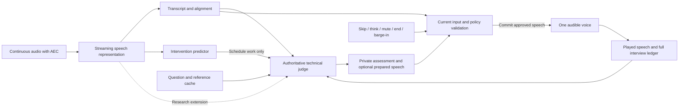

# Architectural proposal: shared inference and guarded speculative execution

17 November 2026. This extends the [initial architecture research](multi-model-voice-architecture.md). It includes an executable scheduling experiment, not a trained speech model or a deployed voice upgrade. No live model or microphone latency is claimed.

## Engineering decision

The strongest near-term optimization is to **perform the same authoritative assessment during the evidence-stability wait, then commit only after the original safeguards pass on the current input**. The stronger research direction is to maintain one question-conditioned streaming representation shared by speech perception, interruption prediction and the authoritative judge, instead of independently reconstructing the conversation for each task.

The product contract stays intact: continuous listening and speaking; candidate barge-in; model-initiated corrections; recovery protection; explicit skip/thinking controls; technical-reference grounding; complete rubric evidence; a full-interview memory; and cancellation that removes unheard speech from context. No smaller predictor gets permission to skip a question, no recovery threshold is weakened, and no functionality is removed to obtain a faster number.

Speculative execution and shared model representations have prior art. The potentially substantial contribution is their integration into a **reference-conditioned interview controller that handles changing speech safely**. Neither originality nor an end-to-end quality-preserving improvement has been established. The experiment below deliberately includes conditions where the proposed optimization is worse.

## Architecture



The dashed edge is a research extension, not an existing capability of our text assessor. The predictor controls scheduling only. It may make a wrong prediction without causing an audible interruption. The complete judge and deterministic policy retain authority.

### 1. Prepare the interview context once

Before a question starts, prepare the exact question, approved technical references, rubric, model instructions and response schema as a stable prefix. Keep candidate text and changing evidence after it. The current three-question reference set is small; a retrieval service is unnecessary for it.

With self-hosted inference, retain the question's KV cache and append new observations. vLLM's automatic prefix caching reuses exact token-prefix blocks and incorporates model-relevant identities such as multimodal data and adapters [3]. A question cache is reusable computation, not a cache of the answer's correctness.

When ASR revises text, reuse only the longest unchanged **token** prefix and recompute the changed suffix. Tokenization at a character boundary can change; a character-prefix match is insufficient. Reusing a factual reference is different from reusing a recovery verdict. “Fatigue never matters” and “Fatigue never matters—that was my original mistake” may share a claim but require different intervention decisions.

Hosted prompt caching can approximate part of this saving, subject to the provider's rules. It does not give this application direct control of KV snapshots or allow KV sharing between unrelated models. Use exact request identities rather than approximate semantic caching for action authorization.

### 2. Move work before the permission to speak

The current app waits before launching most provisional semantic assessments. Instead, launch a bounded preparation on a promising observation while the same evidence guard continues running. At eligibility:

- If an identical assessment is complete, validate and use it.
- If an identical assessment is still running, adopt that job instead of starting a duplicate.
- If anything relevant changed, reject the old assessment and evaluate the current input.
- If a candidate requests thinking time, pauses, ends, changes question or begins a self-correction, re-evaluate the live policy before committing speech.

Use a single canonical request builder for both ordinary and speculative requests. The identity must include session/question epoch, model/configuration, system prompt, question/reference versions, full relevant context, prior evidence, transcript revision, recognition trust and provisional/final status. An exact quote plus a few correction-keyword checks does not establish contextual equivalence.

A successful assessment needs an execution record containing that identity, supported claim/reference, result, eligibility boundary and generation ID. This record proves which computation was used; it is **not proof that the model's claim is true**. Keep semantic grounding and confidence checks. Re-run time budget, thinking protection, recovery checks and action policy using current state. Commit a particular intervention at most once.

Bound speculative launches, protect normal-request capacity, and replace stale pending requests rather than allowing an unbounded queue. A cancelled HTTP request does not guarantee provider compute has stopped. Never let an old completion or cleanup handler overwrite a newer job. Record hit rate, rejected work and fallback latency.

### 3. Prepare audio privately, only when the transport supports it

Pre-generate fixed questions or a likely short correction into a private, bounded audio buffer. Release the correct buffer only after the full decision and latest policy validation. Discard other branches without adding them to heard conversation history. Continue capturing candidate speech throughout preparation and playback.

This is **not implemented by muting the existing native WebRTC audio element**. Muted audio may already be consumed, and provider context can advance. A real preparation path needs explicit buffered rendering, cancellation and a played-sample cursor. For native audio without that contract, implement judgment overlap only and generate speech after commitment. Preserve the selected voice; changing voices to get a cheaper number would alter the experience.

When the candidate interrupts, stop local playback immediately, cancel outstanding generation, clear queued audio and truncate the assistant's context to what was actually played. Generated, received and heard audio are distinct states. Continue preserving the full interview ledger even if a voice model has a short context window.

### 4. Share perception without weakening the judge

Freeze-Omni provides relevant primary-source precedent: a classification layer after its frozen LLM predicts chunk-level conversational state, and per-user speech-encoder/LLM caches are separated from pooled model instances [1]. Its classifier concerns conversation control; it is not an interview-correctness or recovery classifier.

A future implementation could condition the streaming backbone on the current question and expose separate heads for speech/transcript alignment, turn state, error/relevance and recovery. Conceptually:

```text
h_t = Encoder(audio_chunk_t, h_(t-1))
z_t = QuestionConditionedBackbone(h_t, reference_cache, conversation_state)
turn_state, error_signal, recovery_signal = Heads(z_t)
```

Training must include unfinished answers, quoted errors, negation, technical units, spontaneous recovery and actual interventions. A frozen language backbone does not prove that a speech adapter preserves technical accuracy. A useful representation for speech generation is not automatically sufficient for reliable engineering assessment.

Until validated, these heads schedule the unchanged judge. **Adding an audio predictor while retaining a text-only authoritative judge does not remove ASR from the final decision dependency.** Removing that dependency requires the authoritative judge to understand the shared audio representation, while preserving the reference/evidence checks. If the required evidence or alignment is unavailable, the system must still wait. Transcripts and finalized competency evidence remain part of the product.

NVIDIA PersonaPlex is a useful modern full-duplex experimental baseline [2], but its inspected documentation describes a sliding conversational memory of roughly 2.5 minutes despite a pinned system prompt. Replacing our system with it without the external ledger would sacrifice interview memory. It also has no established interview-recovery guarantee.

## Mathematics: what can actually improve

### Hide independent delay instead of removing safeguards

Let `W` be the unchanged evidence wait, `J` the duration of the complete assessment and `δ` the preparation launch delay after the observation. For an identical reusable input and adequate capacity:

```text
serial readiness       = W + J
speculative readiness  = max(W, δ + J)
saving, for δ ≤ W      = min(J, W - δ)
```

The judge and wait are still present. Their dependencies have changed. Voice startup `V` remains after judgment in the current transport:

```text
serial audible onset       = W + J + V + transport/playout
speculative audible onset  = max(W, δ + J) + V + transport/playout
```

If judgment determines the utterance, private voice preparation can at best give `max(W, δ + J + V)` before commit/playout. It is incorrect to claim `max(W,J,V)` unless the exact accepted utterance is independently known early, prepared privately and fully verified. Real queueing, revisions and jitter can reduce or reverse the gain.

### Separate latency savings from compute savings

With one speculative attempt, reuse probability `h`, and one fallback on a miss:

```text
expected assessor calls ≈ 2 - h       versus 1 without speculation
expected latency saving ≈ h × saving_on_hit - contention/fallback penalties
```

Speculation alone can increase compute. Prefix caching and shared perception address that separately. Let `P` be prefill work, `D` decode work and `f` the fraction of prefill eliminated by exact cache reuse. Ignoring overhead and warmup:

```text
ordinary work per opportunity ≈ P + D
prepared work per opportunity ≈ (2 - h) × ((1 - f)P + D)
```

For illustration only, if `P=0.8`, `D=0.2`, `f=0.75` and `h=0.8`, the ratio is `1.2 × (0.2 + 0.2) = 0.48`: 52% less modeled work. These are assumed normalized costs, not measured properties of our assessor. Cache warmup, memory, speculative audio, extra observers and provider billing must be included. If decode dominates or reuse is poor, the benefit can vanish. Admit speculation only where measurements justify it; share exact prefixes regardless of whether speculation is enabled.

A shared encoder removes duplicated encoder work only when the same representation is suitable for all retained tasks. For `k` encoders each costing `E`, independent work `kE + sum(heads)` becomes `E + sum(heads)`, plus the real overhead of coordination and training. It is not a free combination of separate hosted APIs.

### An exact optimization for self-hosted decoding

Standard speculative decoding uses a cheap proposal distribution `q` and the full model's distribution `p`. For a proposed token `y`, accept with `min(1, p(y)/q(y))`; otherwise sample from the normalized positive residual `(p-q)+`. The accepted contribution is `min(p,q)`, the residual contribution is `(p-q)+`, and their sum is `p`.

This preserves the target sampling distribution in ideal arithmetic. It preserves neither factual truth nor an ability to know future speech. vLLM documents numerical limitations and distinguishes standard verification from explicitly lossy variants such as FLy [4]. Choose the standard algorithm if retaining target behavior is a requirement. It is more relevant to lengthy explanations than a tiny decision output, and is not exposed as an application switch on the existing hosted API.

### A limit no architecture can remove

Two candidates can produce an identical prefix: “Fatigue never matters…” One will continue incorrectly; the other will immediately say “…that is the misconception I want to correct.” Before they diverge, a causal controller has the same observations in both cases. It cannot guarantee both instant interruption in the first case and uninterrupted recovery in the second.

Consequently, preserving the same judge and observed-state guards is not proof of identical interview quality. A slow implementation can accidentally hear a later correction before it acts; a faster one may not. Measure this explicitly. Do not call a speedup quality-preserving merely because cache keys and cancellation tests pass. Recovery remains a calibrated probabilistic decision, not certainty about the candidate's future.

## Executable experiment and results

Run from the repository root:

```sh
node --import tsx research/guarded-speculation-evaluate.ts
node --import tsx --test tests/guarded-speculation.test.ts
```

The [simulator](../research/guarded-speculation.ts) uses fixed synthetic assessor verdicts and durations, an externally supplied eligibility time, one non-preemptible worker, exact snapshot identities and a bounded speculation budget. It assumes no free capacity reclamation when work becomes stale. The [raw results](guarded-speculation-results.json) include calls and rejected work.

| Scenario | Serial readiness/interruption | Speculative readiness/interruption | Assessor calls, serial → speculative |
| --- | ---: | ---: | ---: |
| Stable input, `W=900`, `J=600` | 1,500 ms | 900 ms | 1 → 1 |
| Stable input, `W=900`, `J=1,400` | 2,300 ms | 1,400 ms | 1 → 1 |
| Revision at 100 ms, `J=1,800`, same worker | 2,800 ms | 3,600 ms | 1 → 2 |
| Correction arrives before eligibility | No interruption | No interruption | 1 → 2 |
| Candidate ends at the commit boundary | No interruption | No interruption | 0 → 1 |
| Future correction after early valid commitment | No interruption | Harmful interruption at 1,000 ms | 2 → 2 |

These are computed event times, **not measured provider performance**. The first two rows are about 40% and 39% faster in judgment readiness; they are not end-to-end audio speedups. The contention row is approximately 29% slower. The final row is a deliberate counterexample to a universal no-quality-loss claim. It replays a hypothetical unassisted continuation, not a simulation of how a real candidate responds after being interrupted.

The tests cover gate ordering, exact input/epoch/trust revisions, duplicate delivery, stale results, thinking/end controls, failure before and after eligibility, in-flight adoption, one-worker contention and 77 revision/completion boundary combinations. They establish properties of this scheduler experiment, not completeness of a production request serializer or speech system. Thinking protection suppresses that observation; this simulator does not model expiry-driven resumption, pause/reconnect protocols, browser audio, transcripts produced by an actual ASR, or a learned recovery model.

## Preserve functionality before enabling a new path

| Core behavior | Architectural requirement | Evidence required before rollout |
| --- | --- | --- |
| Continuous conversation | Incoming audio continues during judging and speaking; one audible voice | Real microphone tests with overlap, echo and background speakers |
| Mid-answer corrections | Judge can be scheduled before end-of-turn; supported current evidence is mandatory | Continuous-speech technical-error cases without a silence boundary |
| Recovery protection | Live corrections invalidate earlier decisions; same thinking and confidence gates | Held-out recoverable answers and candidate experience comparison |
| Technical accuracy | Same complete judge initially; references and quote/alignment checks retained | Correctness of actual spoken corrections, not just detector labels |
| Evidence and feedback | Finalized evidence processing still completes and distinguishes assisted answers | No lost, duplicated or provisionally credited rubric evidence |
| Full interview memory | External ledger outlives a voice model's local context window | Long-session references, question transitions and reconnects |
| Candidate control | End/pause/mute/skip/thinking and barge-in invalidate or revalidate work | Boundary races and real cancellation/playback tests |
| Reliable operation | Bounded jobs, normal-path capacity, provider failure fallback | Load tests including poor hit rates, timeouts and slow cancellation |

Implementation order is deliberate: centralize the exact request builder and instrument baseline → prepare the same judge in shadow mode → enable exact cached/in-flight reuse only after evaluation → build genuine private audio buffering → investigate the shared audio backbone. Keep a feature-gated ordinary path throughout. The current production runtime is not modified by this research commit.

The release decision must consider harmful cuts, missed errors, correction correctness, evidence completeness, p50/p95 audible latency, candidate experience and cost together. A statistical quality comparison needs held-out candidates and explicitly defined uncertainty criteria; passing this deterministic simulation cannot establish no degradation. If faster commitment increases harmful interruptions, the proposed path fails the user's requirement until the policy and calibration resolve it.

## Primary sources inspected

1. [Freeze-Omni official README](https://github.com/VITA-MLLM/Freeze-Omni/blob/163a24880e533b2a07038fb8dcfe02dbbb8457e6/README.md): frozen backbone, chunk-level state classification and pooled instances with per-user inference state. Its architectural claims do not establish interview capability.
2. [NVIDIA PersonaPlex official README](https://github.com/NVIDIA/personaplex/blob/16419a2ef7b98611f58c9df07477d00e5ad61d5f/README.md): full-duplex role/voice conditioning, pinned prompt, batched prompt prefill and limited sliding conversational memory.
3. [vLLM automatic prefix caching](https://github.com/vllm-project/vllm/blob/26acafd3a5aab86d76f44a42787f2d53cf6c5a8b/docs/design/prefix_caching.md): exact prefix blocks, identities and cache lifecycle.
4. [vLLM speculative decoding](https://github.com/vllm-project/vllm/blob/26acafd3a5aab86d76f44a42787f2d53cf6c5a8b/docs/features/speculative_decoding/README.md): verification methods, applicable workloads and distribution-preservation limits.

[1]: https://github.com/VITA-MLLM/Freeze-Omni/blob/163a24880e533b2a07038fb8dcfe02dbbb8457e6/README.md
[2]: https://github.com/NVIDIA/personaplex/blob/16419a2ef7b98611f58c9df07477d00e5ad61d5f/README.md
[3]: https://github.com/vllm-project/vllm/blob/26acafd3a5aab86d76f44a42787f2d53cf6c5a8b/docs/design/prefix_caching.md
[4]: https://github.com/vllm-project/vllm/blob/26acafd3a5aab86d76f44a42787f2d53cf6c5a8b/docs/features/speculative_decoding/README.md
